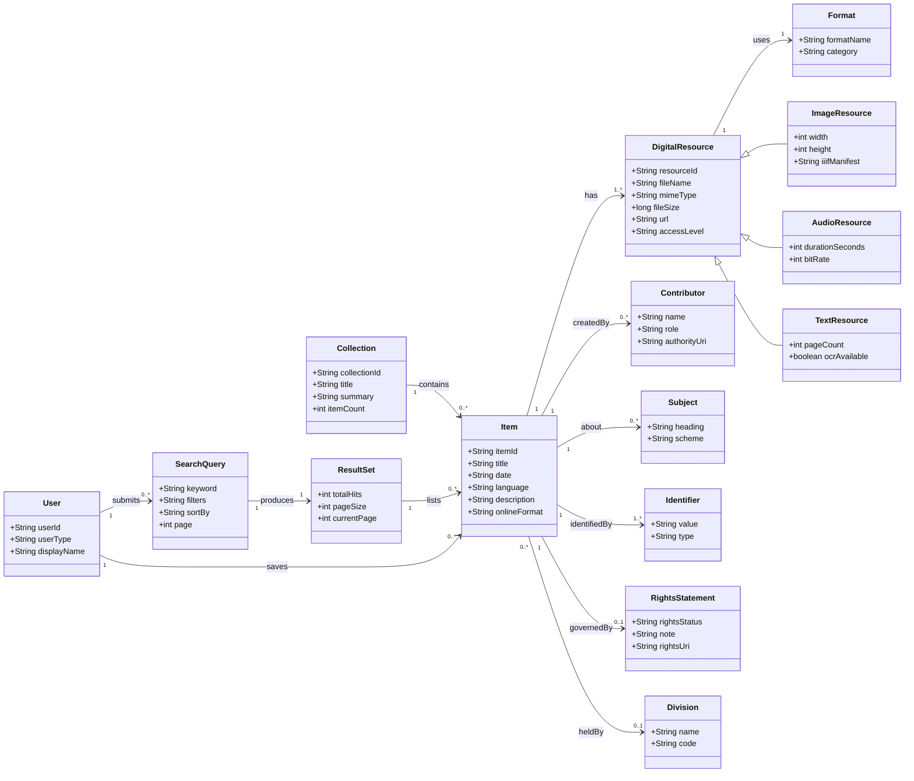
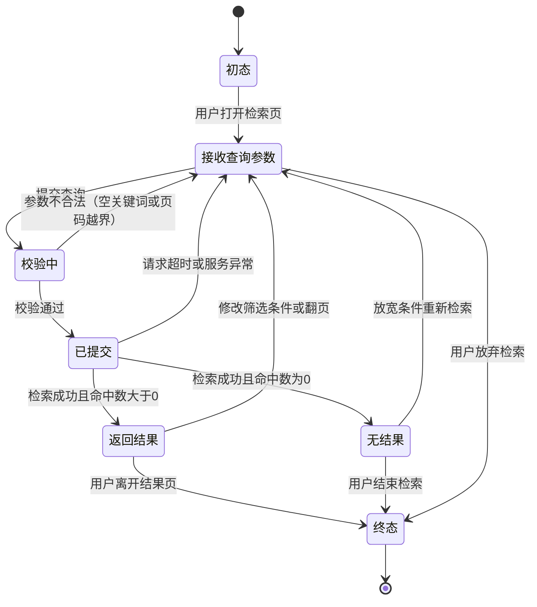
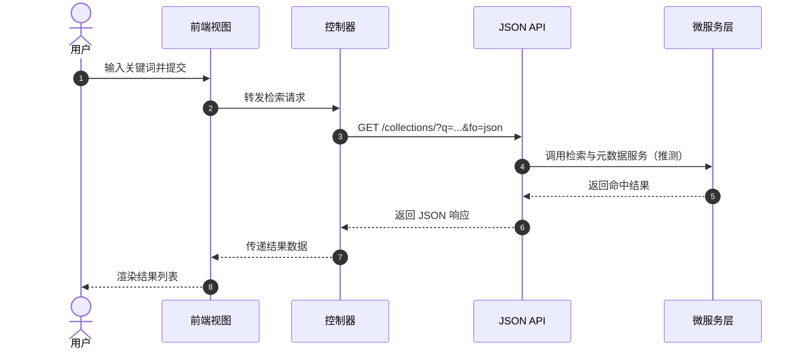
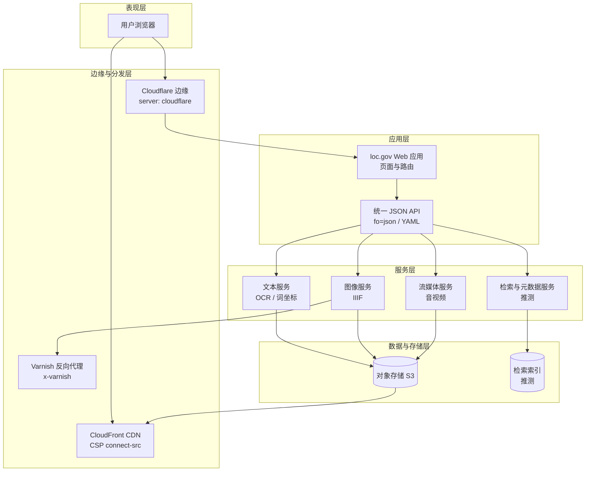
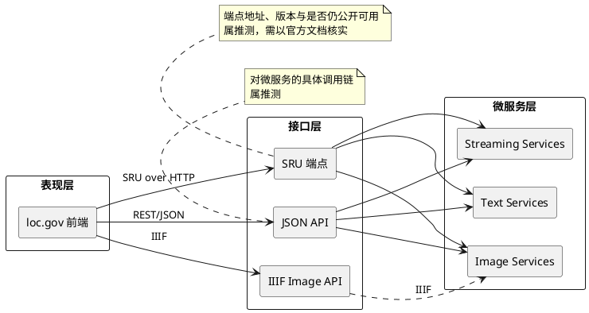

---
AIGC:
    Label: "1"
    ContentProducer: 001191110102MACQD9K64018705
    ProduceID: 1501291830056544_0-drive/226325778894316624/软件工程作业/loc.gov_软件工程作业.md
    ReservedCode1: ""
    ContentPropagator: 001191110102MACQD9K64028705
    PropagateID: 1501291830056544#1794573585552
    ReservedCode2: ""
---
# loc.gov 软件系统分析作业

**分析对象：** 美国国会图书馆网站 loc.gov

**分析视角：** 把 loc.gov 看作一个软件系统，分别从领域建模、应用架构、接口设计三个角度分析。

**方法说明：** 本次分析主要依据三类材料：一是 loc.gov 官方 API 页面（https://www.loc.gov/apis/）的公开说明；二是浏览器访问时返回的 HTTP 响应头；三是页面 URL 与接口路径的公开可见结构。受条件限制，部分内部实现无法直接验证，文中统一标注为“推测”。

**标注约定：**
- 未特别说明的，为页面或响应头中可直接观察到的内容。
- 标注“推测”的，是从外部现象反推、无法直接验证的部分。

---

# 一、第 8 章 领域建模

## 1. 领域类图

### 1.1 建模思路

我把 loc.gov 中反复出现的业务概念抽象成 15 个类。选类的标准是：它在页面上有稳定的业务含义，并且和其他概念存在明确关系。界面按钮、页面区块这类元素不作为类。

其中设置了一组泛化关系：数字资源（DigitalResource）是父类，图像、音频、文本资源是子类。这样可以把公共属性放在父类，把各自特有的属性放在子类，避免父类属性过多。

### 1.2 Mermaid 代码

### 1.3 关系说明

**一对多关系：**

| 关系 | 含义 |
|---|---|
| Collection 1 → 0..* Item | 一个合集包含多个条目 |
| Item 1 → 1..* DigitalResource | 一个条目可能对应多个数字文件 |
| Item 1 → 0..* Contributor | 一个条目可以有多个责任者 |
| Item 1 → 0..* Subject | 一个条目可以挂多个主题词 |
| Item 1 → 1..* Identifier | 一个条目通常有多个编号 |
| ResultSet 1 → 0..* Item | 一次检索命中多个条目 |
| User 1 → 0..* SearchQuery | 一个用户可以发起多次检索 |

**泛化关系：**

DigitalResource 是父类，ImageResource、AudioResource、TextResource 是子类。父类放资源编号、文件名、MIME 类型、大小、地址、访问级别；子类分别放宽高、时长码率、页数与 OCR 状态。

### 1.4 各类对应的页面或功能

| 类 | 对应的页面或功能 |
|---|---|
| Collection | 首页和检索页中的合集入口，点进去是该合集下的条目列表 |
| Item | 条目详情页，是网站最核心的业务对象 |
| DigitalResource | 详情页中“查看/下载”的实际文件 |
| ImageResource | 图片类条目的预览与放大查看 |
| AudioResource | 录音、口述历史类条目的播放功能 |
| TextResource | PDF、全文、OCR 文本类资源 |
| Format | 详情页的格式字段 |
| Contributor | 详情页的作者、摄影者、机构字段 |
| Subject | 详情页的主题词和分类标签 |
| Identifier | 详情页的 LCCN、ISBN 等编号 |
| RightsStatement | 详情页的权利说明区 |
| Division | 条目所属部门或馆藏地（字段映射为推测） |
| SearchQuery | 检索页地址栏中的关键词、筛选和排序参数 |
| ResultSet | 检索结果列表与命中总数提示 |
| User | 访客与登录用户（权限差异为推测） |

> 推测说明：ImageResource 的 `iiifManifest` 字段、DigitalResource 的 `accessLevel` 取值、Division 的字段映射、User 的权限划分，均属于推测，页面上不一定直接暴露。

---

## 2. 状态图

### 2.1 建模思路

状态图以 SearchQuery（检索请求）为主角，描述一次检索从用户输入到结束的过程。之所以选它，是因为检索是 loc.gov 最主要的入口功能，状态变化也比较完整。

图中保留了三个“回退”路径：参数不合法回到接收参数、请求异常回到接收参数、无结果后放宽条件重新检索。这样能体现检索是一个可以反复调整的过程，而不是一次性的直线流程。

### 2.2 Mermaid 代码

### 2.3 说明

图中的状态分为三类：正常路径（接收参数 → 校验 → 提交 → 返回结果）、异常路径（校验失败、请求超时）、空结果路径（无结果后重新检索）。

“校验中”这个状态是根据检索页的 URL 参数推断出来的，页面上不一定有明显的加载提示。“请求超时”的具体阈值、“参数不合法”的具体判定规则，属于推测，作业中不写具体数值。

---

## 3. 顺序图

### 3.1 建模思路

顺序图选取“用户检索并查看结果”这一个场景，参与者按作业要求设为五层：用户、前端视图、控制器、JSON API、微服务层。

需要说明的是，微服务层是根据官方 API 页面中“microservices”的说明加入的，具体调用关系属于推测。

### 3.2 Mermaid 代码

### 3.3 说明

这段交互体现的是分层调用：用户只和前端视图交互，前端把请求交给控制器，控制器再调用 JSON API，API 后面还有一层服务。

从架构上看，它说明页面不直接访问数据，而是统一经过接口层。至于控制器是前端路由还是服务端控制器、微服务层内部如何拆分，外部无法确认，属于推测。

---

# 二、第 10 章 应用架构分析

## 1. 架构判断与证据

| 判断 | 证据 | 结论强度 |
|---|---|---|
| 微服务 / SOA | 官方 API 页面写明站点提供 “suite of microservices”，并分为 Text Services（全文 OCR、词坐标、上下文片段）、Image Services（遵循 IIIF）、Streaming Services（音视频） | 官方文档，可确认 |
| API 优先、页面与数据同源 | 官方说明该 API “originally designed to power the loc.gov website”，同一接口既能输出网页 HTML，也能通过 `fo=json` 输出结构化数据 | 官方文档，可确认 |
| 前后端分离 | 页面通过统一 JSON API 取数，前端负责渲染；但同一端点仍承担页面输出 | 部分成立 |
| 云 + CDN | 响应头出现 `server: cloudflare`、`cf-ray`；CSP 的 `connect-src` 含 `*.s3.us-east-1.amazonaws.com` 与 `d3c605m4lmznjl.cloudfront.net`；`tile.loc.gov` 返回 `x-varnish` | 实测响应头，可确认 |
| 开放接口 | `access-control-allow-origin: *`、HTTP/2、HSTS、ETag / Expires | 实测响应头，可确认 |
| MVC | 页面、路由、数据接口呈现“视图—控制器—模型”式分工 | 推测 |
| 内容协商式输出 | 同一路径加 `fo=json` 可切换 HTML / JSON / YAML | 官方文档，可确认 |

## 2. 证据来源与限制

本次使用的证据只有三类：官方 API 页面的原文说明、对 `www.loc.gov/apis/` 与 `tile.loc.gov` 的响应头实测、CSP 策略中暴露的域名。

需要说明的是，直接抓取 JSON 正文时被 Cloudflare 的人机校验拦截，因此没有取得 JSON 字段级证据。凡是涉及 JSON 内部字段结构的描述，本文都不作确定性表述。

## 3. 架构分析段落

从外部可观测的证据看，loc.gov 属于“API 驱动 + 微服务 + 云边缘分发”的分层架构。首先，官方 API 页面明确说明站点提供一套微服务，并将其分为文本服务、图像服务和流媒体服务三类，其中图像服务遵循 IIIF 标准，因此微服务 / SOA 的判断有官方文档直接支撑，并非推测。其次，官方同时说明该 JSON API 最初就是为驱动 loc.gov 网站而设计，同一接口既能返回页面 HTML，也能通过 `fo=json` 返回结构化数据，这说明页面与数据同源、由 API 统一供给，属于 API 优先架构；但严格意义上的“前后端完全分离”只能算部分成立，因为同一端点仍承担页面输出。第三，响应头显示 `server: cloudflare` 与 `cf-ray`，CSP 的 `connect-src` 又列出 CloudFront 域名和 S3 存储地址，`tile.loc.gov` 还返回 `x-varnish`，说明其使用 Cloudflare 边缘、CloudFront 与 S3 存储分发，以及 Varnish 反向代理缓存，云 + CDN 的判断证据比较充分。MVC 只能标为推测：页面、路由与数据接口呈现类似“视图—控制器—模型”的分工，但外部无法确认其具体框架。总体看，这是一个围绕统一 JSON API 组织、由多类专用微服务支撑、并借助 CDN 与缓存层对外分发的大型内容型系统。

## 4. 架构层次简图

---

# 三、第 11 章 接口设计分析

## 1. 构建图

### 1.1 建模思路

构建图按三层组织：表现层是 loc.gov 前端；接口层是三个对外入口（JSON API、SRU 端点、IIIF Image API）；微服务层是三类专用服务。

依赖关系按作业要求设置：前端依赖三个接口；JSON API 和 SRU 端点依赖微服务层；IIIF Image API 与图像服务之间用虚线表示实现关系。

### 1.2 PlantUML 代码

## 2. 接口技术判断

### ① RESTful JSON API 的证据

官方 API 页面明确说明 loc.gov 提供 JSON API，且该 API 最初就是为驱动网站而设计，可通过 `fo=json` 输出结构化数据。

从外部可观察到的特征也符合 REST 风格：使用资源化路径（如 `/collections/`、`/item/`）、使用 GET 查询参数（`q`、`fa`、`c`、`sb`）、请求无状态、使用标准 HTTP 状态码，响应头 `access-control-allow-origin: *` 支持跨域调用。

严格来说，这只说明它具备 RESTful 风格。公开能观察到的只有 GET 请求，没有看到 PUT、DELETE 等完整动词集，所以不宜说成“完整的 REST 实现”。

### ② SRU 是什么

SRU 是 Search/Retrieve via URL 的缩写，是图书馆领域的一种标准检索协议，可以看作 Z39.50 在 HTTP 上的后继方案。

它的特点是把检索条件放在 URL 参数里，例如 `operation=searchRetrieve`、`version`、`query`（用 CQL 表达），服务端返回 XML 格式的 `searchRetrieveResponse`。它主要用于跨馆书目系统的互操作，因此出现在 loc.gov 这类图书馆系统中是合理的。

### ③ IIIF 是什么

IIIF 是 International Image Interoperability Framework 的缩写，是一套图像互操作标准，主要包括 Image API 和 Presentation API。

Image API 通过 URL 路径描述区域、尺寸、旋转、质量和格式，按需返回切片或缩放图；Presentation API 用 manifest 描述一组图像及其结构。

loc.gov 官方 API 页面明确写明其 Image Services 提供 “IIIF-compliant API”，因此这一项有官方证据支撑，不是推测。

### ④ 哪些是推测

- SRU 端点的具体地址、版本、是否仍对外公开：推测，本次未取得官方端点文档。
- JSON API 与 SRU 是否真的调用同一组微服务、具体调用链如何：推测，外部只能看到接口，看不到内部编排。
- 前端是否由浏览器直接请求 IIIF 切片，而不是经服务端转发：推测，取决于具体页面实现。
- Text Services 与 Streaming Services 是否都被 JSON API 聚合：推测，官方只说明它们存在，未说明聚合方式。
- 微服务之间的相互调用关系与部署边界：推测。

有官方证据的部分是三项：JSON API 的存在与用途、微服务三分法（Text / Image / Streaming）、Image Services 的 IIIF 合规性。

---

# 附录：图的渲染方法

| 图 | 语法 | 推荐网站 |
|---|---|---|
| 类图 | Mermaid | https://mermaid.live |
| 状态图 | Mermaid | https://mermaid.live |
| 顺序图 | Mermaid | https://mermaid.live |
| 架构层次图 | Mermaid | https://mermaid.live |
| 构建图 | PlantUML | https://www.plantuml.com/plantuml |

使用方法：把对应代码块里的内容粘贴到网站左侧编辑区，右侧会生成图形，右上角可以导出 PNG 或 SVG。

---

# 参考资料

1. Library of Congress. APIs at the Library of Congress. https://www.loc.gov/apis/
2. Library of Congress. loc.gov Collections. https://www.loc.gov/collections/
3. loc.gov 页面与 `tile.loc.gov` 的 HTTP 响应头（2026 年 11 月实测）。

---

> 本内容由 Coze AI 生成，请遵循相关法律法规及《人工智能生成合成内容标识办法》使用与传播。
